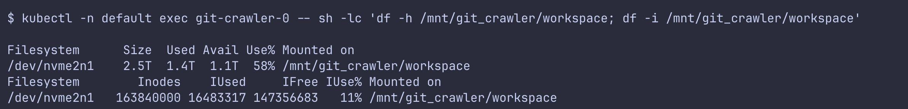

SELinux relabeling is the process used by Kubernetes Nodes running SELinux to establish the security boundary for different pods accessing data stored in Persistent Volumes.

:::warning
SELinux relabeling is by _default_ a recursive walk over all files. This can cause timeouts during container creation when we have a large amount of data (**5TB+**) stored in a single EBS volume.
:::

In this article I will cover details about the workings of SELinux, issue associated with the current relabeling process, kernel based context aware volume mount, activating a beta [KEP](https://kubernetes.io/blog/2026/04/22/breaking-changes-in-selinux-volume-labeling/) for resolving the timeout issue while ensuring we don't lose any data.

## Security Enhanced Linux
[Security-Enhanced Linux (SELinux)](https://www.redhat.com/en/topics/linux/what-is-selinux) is a security architecture that allows administrators more control over data access policies.

:::info
It was originally developed by the United States **National Security Agency (NSA)** as a series of patches to the Linux kernel.
:::

SELinux can be enabled or [disabled](https://docs.redhat.com/en/documentation/red_hat_enterprise_linux/8/html/using_selinux/changing-selinux-states-and-modes_using-selinux#Enabling_and_Disabling_SELinux-Disabling_SELinux_changing-selinux-states-and-modes). When enabled, SELinux has two modes:
- permissive: SELinux policy is not enforced but logging happens for denied operations.
- enforcing: SELinux policy is enforced and operations would be denied.

The mode can be changed by setting `SELINUX=permissive|disabled|enforcing` in `/etc/selinux/config` and then restarting the system.

The SELinux mode of a running system can be checked by running
```bash
> getenforce
0 # permissive

> getenforce
1 # enforcing
```

### Cloud Providers
Each Cloud Provider has its own variant of a recommended operating system for hosting container workloads which might use SELinux

| Cloud | Service | Operating System           | SELinux Mode |
| ----- | ------- | -------------------------- | ------------ |
| AWS   | EKS     | Bottlerocket               | Enforcing    |
| Azure | AKS     | Azure Linux Container Host | Enforcing    |
| GCP   | GKE     | Container Optimized OS     | -            |

For checking on an EKS node we can start a debug pod as `ssh` is disabled on EKS:
```bash
kubectl get pod git-crawler-0 -o wide
kubectl debug node/ip-10-1-11-111.us-east-1.compute.internal -it --image=ubuntu:22.04 --profile=sysadmin
root@ip-10-1-45-192:/# cat /host/etc/selinux/config
SELINUX=enforcing
SELINUXTYPE=fortified
```

GKE's COS doesn't support SELinux, there is no explicit mention anywhere even though it uses [Chromium OS](https://www.chromium.org/chromium-os/developer-library/reference/security/selinux/) which supports SELinux. The only verification is the absence of a SELinux config file on a node running COS:
```bash
❯ kubectl debug node/gke-glean-cluster-git-crawler-e2-high-01f1101f-ff1f -it --image=ubuntu:22.04 --profile=sysadmin
root@gke-glean-cluster-git-crawler-e2-high-01f1101f-ff1f:/# ls /host/etc/selinux
ls: cannot access '/host/etc/selinux': No such file or directory
```

:::info
COS supports different [security configurations](https://docs.cloud.google.com/container-optimized-os/docs/concepts/security).
:::

### Process & File Labels
SELinux works by associating _labels_ with subjects (processes) and objects (such as files).

These labels are called [SELinux Contexts](https://docs.redhat.com/en/documentation/red_hat_enterprise_linux/6/html/security-enhanced_linux/chap-Security-Enhanced_Linux-SELinux_Contexts), which contain information about SELinux user, role, type and optionally a level.

We won't go too deep into them, just understanding that only processes with SELinux Context same as a file can access it is sufficient for now.

For example, only a process with the label `...:container_t:s0:c309,c383` can access files with label `container_file_t:s0:c309,c383`

:::important
Even processes running as root (UID 0) are denied access to these files, unless they run with the right SELinux label.
:::

We can check the label for a file or process as shown below
```bash
> ls -Z file
-rw-rw-r--  user1 group1 unconfined_u:object_r:user_home_t:s0 file

> ps -eZ | grep passwd
system_u:system_r:dhcpc_t:s0             1869 ?  00:00:00 dhclient
system_u:system_r:sshd_t:s0-s0:c0.c1023  1882 ?  00:00:00 sshd
system_u:system_r:gpm_t:s0               1964 ?  00:00:00 gpm
system_u:system_r:crond_t:s0-s0:c0.c1023 1973 ?  00:00:00 crond
system_u:system_r:kerneloops_t:s0        1983 ?  00:00:05 kerneloops
system_u:system_r:crond_t:s0-s0:c0.c1023 1991 ?  00:00:00 atd
```

The container runtime on SELinux assigns a unique random label to each container (process) if not explicitly set in the container.

Label assignment ensures that a process that maliciously escapes the container boundary cannot access data of any other container on the host node.

### Recursive Relabeling
The container runtime does a _recursive walk_ of all the files that are visible to the Pod's container including volume mounts and changes the SELinux label to match the one assigned to the Pod.

This can be [time-consuming](https://bugzilla.redhat.com/show_bug.cgi?id=1459106) if there are many files on the volume, especially when the volume is on a remote filesystem (EBS, Persistent Disk, Azure Disk, etc.)

:::warning
Relabeling can also fail in cases where the disk runs out of space because assigning files a label requires additional space.
:::

The issue we faced with our Git Crawler service was the prior one. The data stored on disks was of the order of 5TB+ leading to an extremely high count of [inodes](https://www.kernel.org/doc/html/latest/filesystems/ext4/inodes.html) due to the presence of too many small files.


The issue used to happen in the order below:
- Recursive walk used to time out
- The container runtime tries to create a new pod
- The name of pod `git-crawler-0` is still held by the [previous pod](https://github.com/containerd/containerd/issues/4604#issuecomment-1027293621)
- The container runtime keeps failing to bring up a pod
```json
"containerStatuses": [
      {
        "name": "git-crawler",
        "state": {
          "waiting": {
            "reason": "CreateContainerError",
            "message": "failed to reserve container name \"git-crawler_git-crawler-0_default_e3901bc1-120f-4cd8-a97a-fe5eb3e766ca_257\": name \"git-crawler_git-crawler-0_default_e3901bc1-120f-4cd8-a97a-fe5eb3e766ca_257\" is reserved for \"b6eaed8ab5675f2c339e306ad044012323830687b17553fa24baa8e2d13e8727\""
          }
        },
        "lastState": {},
        "ready": false,
        "restartCount": 256
	}
]
```

## Disk Corruption
In my blog [the uptime we owed our git crawler](/posts/oom-prevention) we utilised readiness and health check probes to manage memory because we were under the assumption that OOMs were leading to disk corruption.

This initial triage was based on the error we saw `input/output error` after running the operations below
1. Cordon the associated node for pod
2. Force delete the pod
3. Delete the stale volume attachment binding volume to old node
4. Create the pod again

```bash
Error: failed to generate container "50083e651c70ee8ca16f7ff411ef8ff762a36f41ca15b704a63777ef47055196" spec: failed to apply OCI options: relabel "/var/lib/kubelet/pods/32689181-f2a0-499a-affb-6ba14a16db84/volumes/kubernetes.io~csi/pvc-465151e4-06bc-4636-b7a5-a0aa87ca05eb/mount" with "system_u:object_r:data_t:s0:c346,c780" failed: readdirent /var/lib/kubelet/pods/32689181-f2a0-499a-affb-6ba14a16db84/volumes/kubernetes.io~csi/pvc-465151e4-06bc-4636-b7a5-a0aa87ca05eb/mount/1BCD4C00FB3CA92E58B2C2516FB688A5/github/chromium-src/third_party/blink/web_tests/external/wpt/css/geometry: input/output error
```

:::info
Cordoning a node prevents new pods from being scheduled on it.
:::

Only later I tried to verify the authenticity of this claim by attaching the assumed _corrupted volume_ to an EC2 instance and running [fsck](https://linux.die.net/man/8/fsck) (file system check) and [chcon](https://linux.die.net/man/1/chcon) (assign SELinux label to file):
```bash
$ sudo fsck.ext4 -fn /dev/nvme2n1
e2fsck 1.46.5 (30-Dec-2021)
Warning!  /dev/nvme2n1 is mounted.
Pass 1: Checking inodes, blocks, and sizes
Pass 2: Checking directory structure
Pass 3: Checking directory connectivity
Pass 4: Checking reference counts
Pass 5: Checking group summary information
/dev/nvme2n1: 16483317/163840000 files (0.1% non-contiguous), 380737401/655360000 blocks

$ sudo chcon -R system_u:object_r:data_t:s0:c520,c1002 \
  "/mnt/triage-ebs/D4C00FB3CA92E58B2C2516FB688A5/github/chromium-src/third_party/blink/web_tests/external/wpt/css/geometry"
$ echo $?
0
```

Given both of the above worked, it proved that the disk wasn't _corrupted_ and instead it was a purely SELinux timing issue.

:::bug
Still haven't been able to reason about why we saw an `input/output` error on cordoning the node?
:::

## Context Aware Mount
Linux kernel `mount` command supports mounting volumes with a specific SELinux label ([context](https://man7.org/linux/man-pages/man8/mount.8.html#:~:text=context%3Dcontext%2C%20fscontext%3Dcontext%2C%20defcontext%3Dcontext%2C%20and%0A%20%20%20%20%20%20%20rootcontext%3Dcontext)) which assigns the entire volume one security context/SELinux label preventing the need for recursive relabeling.
```sh
mount -o context=system_u:system_r:container_t:s0:c309,c383 <what> <where>
```

:::info
This was the improvement which was raised as part of [storage SIG]() [Kubernetes Enhancement Proposal](https://github.com/kubernetes/enhancements/tree/master/keps/sig-storage/1710-selinux-relabeling#story-3-cluster-upgrade).
:::

###  Cluster Feature Flag
The feature was gated behind three flags:
- `SELinuxMountReadWriteOncePod`
- `SELinuxChangePolicy`
- `SELinuxMount`

The feature was getting rolled out first to only persistent volumes with [access mode](https://kubernetes.io/docs/concepts/storage/persistent-volumes/#access-modes) "Read Write Once Pod" which basically allows only a single writer for the mounted volume.

:::info
ReadWriteOncePod was made stable in v1.29 of Kubernetes.
:::

The feature controlling it, `SELinuxMountReadWriteOncePod`, was still a beta flag (GAed in v1.36), which meant cluster operators needed to opt in starting from v1.28.

We use EKS for running Kubernetes on AWS. To check whether features are enabled or not, we can run the command below
```bash
kubectl get --raw /metrics | grep kubernetes_feature_enabled
```

From it we found it was enabled by default on EKS for v1.33 so we were good to go further.
```
kubernetes_feature_enabled{name="SELinuxChangePolicy",stage="BETA"} 1
kubernetes_feature_enabled{name="SELinuxMount",stage="BETA"} 0
kubernetes_feature_enabled{name="SELinuxMountReadWriteOncePod",stage="BETA"} 1
```

:::important
Kubernetes cluster upgrades need careful testing and monitoring to prevent regressions. We were only running Kubernetes v1.33 in the duration of migration (March). Currently also we are still at v1.35 and v1.36 upgrade is in progress. 
:::

### CSI Feature Flag
The proposal also required `CSI` (Container Storage Interface) drivers to update their specification to declare whether they [support](https://github.com/kubernetes/enhancements/blob/master/keps/sig-storage/1710-selinux-relabeling/README.md#proposal:~:text=Allow%20CSI%20drivers%20to%20announce%20if%20they%20support%20mounting%20with%20%2Do%20context%20mount%20option%20via%20CSIDriver%20spec.SELinuxMount%20bool%20field.) context aware mount or not.

Given we maintain the EBS CSI driver as an addon using Terraform, I had to update the specification for the addon as below to enable [SELinux mount](https://github.com/kubernetes-sigs/aws-ebs-csi-driver/pull/2253) which sets the [CSI Specification](https://github.com/kubernetes-sigs/aws-ebs-csi-driver/pull/2507) flag correctly:
```terraform
{
	addon_name               = "aws-ebs-csi-driver"
	configuration_values     = jsonencode({
	node = {
		selinux = var.glean_config["eks.ebs_csi.selinux_mount.enabled"] == "true"
	  }
	})
}
```

I was advised to make this change in a flag-gated manner because an infrastructure change needs to go through enough _soaking_ in pre production environments before it reaches customers.

:::bug
Changing default to `true` led to an outage for a few customers because there were EKS nodes running [Amazon Linux 2](https://aws.amazon.com/amazon-linux-2/) in their clusters, which doesn't support SELinux. So it was reverted and after we migrated to [Bottle Rocket OS](https://bottlerocket.dev/) it was enabled again.
:::

### Pod Security Context
The feature also requires that we set a SELinux context level for the pods. By default container runtime gives a random label which isn't sufficient for this feature to work. So, we updated our git crawler StatefulSet specification for the same.
```hcl
spec {
	security_context {
		se_linux_options {
			level = "s0:c8,c1001"
		}
}
```

### PV Access Mode
This was the final task needed as part of migration. As mentioned above, the feature was only supported for `ReadWriteOncePod` access mode until our current Kubernetes cluster v1.33.

We didn't want to lose data that was already crawled. So to change the access mode of volume without losing any data we had to follow below [procedure](https://kubernetes.io/docs/tasks/administer-cluster/change-pv-access-mode-readwriteoncepod/):

First we proceed with backing up the current PVC specification so that we can re-create it by changing only the things we need to while retaining the rest of the properties.
```bash
kubectl get pvc git-crawler-data-git-crawler-0 -o json
```

Next we need to scale down the StatefulSet and also force delete the pod so the PVC is free for deletion.
```bash
kubectl scale sts git-crawler --replicas 0
kubectl delete pod git-crawler-0 --force --grace-period 0 --ignore-not-found=true
```

:::info
Replica scaling is an _asynchronous process_ and we want to do things in one shot, so we had to do force deletion for making it synchronous.
:::

Given our Persistent Volume (PV) was created with a reclaim policy of delete, it would get deleted when in the next step we delete the Persistent Volume Claim (PVC). So to prevent that we need to change its reclaim policy to `Retain`.
```bash
export PV_NAME=$(cat pvc_backup.json | jq .spec.volumeName)
kubectl patch pv $PV_NAME --patch "{'spec':{'persistentVolumeReclaimPolicy': 'Retain'}}"
```

Now we can proceed with deleting the PVC. We have to do this because PVC is immutable and we can't change its access mode.

PVC deletion is also an asynchronous process so we have to busy loop until we can't `get` it.
```bash
kubectl delete pvc git-crawler-data-git-crawler-0

# in a loop poll on below command to error out
kubectl get pvc git-crawler-data-git-crawler-0
```

Now, we will update the access mode of our PV
```bash
kubectl patch pv $PV_NAME --patch "{'spec':{'accessModes': ['ReadWriteOncePod']}}"
```

We also need to unset its `claimref` so that the new PVC we will create from backup can be associated with it
```bash
kubectl patch pv $PV_NAME --patch "{'spec':{'claimRef': null}}"
```

Now, we will recreate our PVC back from the backup to match everything exactly
```python
def _create_pvc_from_backup(self, kubectl: KubectlWrapper, pvc_backup: dict[str, Any])
	pvc_manifest = {
		'apiVersion': 'v1',
		'kind': 'PersistentVolumeClaim',
		'metadata': {
			'name': pvc_backup['metadata']['name'],
			'namespace': pvc_backup['metadata'].get('namespace', self.namespace),
		},
		'spec': dict(pvc_backup['spec']),
	}
	
	labels = pvc_backup.get('metadata', {}).get('labels')
	if labels:
		pvc_manifest['metadata']['labels'] = labels
	
	annotations = pvc_backup.get('metadata', {}).get('annotations')
	if annotations:
		pvc_manifest['metadata']['annotations'] = annotations

	pvc_manifest['spec']['accessModes'] = [_TARGET_ACCESS_MODE]
	
	with tempfile.NamedTemporaryFile(mode='w', suffix='.json', delete=False) as tmp:
		json.dump(pvc_manifest, tmp)
		tmp_path = tmp.name
	
	kubectl.exec_cmd(['create', '-f', tmp_path])
```

Finally, we can scale our StatefulSet back up, and by already having the correct PVC in place, it will get associated with the pod as it was before.
```bash
kubectl scale sts git-crawler --replicas 1
```

:::note
We did update our StatefulSet template so that newly created PVs and PVCs carry the access mode of `ReadWriteOncePod` from the beginning.
:::

## Eureka!
After all this we finally were able to support even customers who have **5TB+** data and more than **16M** files/inodes on a single volume of git crawler service.

I really got to learn a lot of Kubernetes-related concepts and operations because of this particular caveat/problem I encountered. I even read through a whole KEP which was pretty insightful.
:::warning
This also did delay the full rollout by quite some time.
:::

The end result though was all our customers are running Git Crawler in Kubernetes now which supports:
- Zero Downtime
- Vertical Pod Autoscaling
- PVC Automatic Resizing
- Observability

We entered an operational heaven with all this and had `0` issues related to our Git Crawler Service.

That's all for now, thanks for reading. It really took me quite some time to write this **particular** one because of so many technical concepts which I had to read thoroughly before I could take a shot at explaining them to anyone.


Cover Photo by <a href="https://unsplash.com/@nainoa">Nainoa Shizuru</a> on <a href="https://unsplash.com/photos/concert-photos-NcdG9mK3PBY">Unsplash</a>
